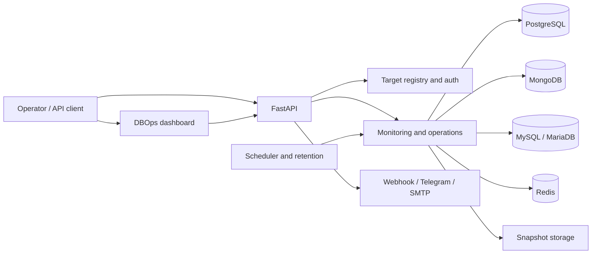

<div align="center">

# DBOps Control Plane

### One dashboard for database health, snapshots, recovery, and operations.

Monitor PostgreSQL, MongoDB, MySQL/MariaDB, and Redis from a self-hosted control plane. Automate PostgreSQL backups, verify archives, and rehearse recovery into an isolated database.

<p>
  <a href="https://www.python.org/"></a>
  <a href="https://fastapi.tiangolo.com/"></a>
  <a href="https://www.docker.com/"></a>
  
</p>

</div>

---

## The problem

Operating several database engines often means switching between separate dashboards and scripts. Backup jobs can succeed without proving that their archives are usable, while a restore attempted against a live database can put real data at risk. It is also easy for monitoring tools to have broader database permissions than they need.

## The approach

DBOps brings common operational workflows into one self-hosted dashboard and API. It separates read-oriented monitoring from explicit actions, supports PostgreSQL snapshot verification and isolated clone restores, and keeps database and remote-server credentials encrypted at rest. The aim is to make routine checks easier to see and recovery steps easier to rehearse.

## At a glance

- **One operations dashboard** for registered database targets, health, metrics, activity, and alerts.
- **Four engine integrations** for PostgreSQL, MongoDB, MySQL/MariaDB, and Redis, with engine-specific monitoring coverage.
- **PostgreSQL backup and recovery** with scheduled snapshots, retention, archive verification, and restore into a new database.
- **Storage options** for mounted repositories and verified copies to registered remote Linux servers, which can also host newly provisioned PostgreSQL, MongoDB, MySQL/MariaDB, and Redis containers.
- **Operational controls** for latency checks and explicit query termination, with documented impact.
- **Self-hosted deployment** using Docker Compose or a local Python environment.

## Architecture



## Supported capabilities

| Capability | PostgreSQL | MongoDB | MySQL / MariaDB | Redis |
|---|---:|---:|---:|---:|
| Register and monitor | Yes | Yes | Yes | Yes |
| Health and engine-specific metrics | Yes | Yes | Yes | Yes |
| Snapshot creation | Yes | — | — | — |
| Archive verification and restore | Yes | — | — | — |
| Query / operation termination | Yes | Yes | Yes | — |

Monitoring coverage varies by engine and permission level. Registration confirms connectivity; it does not prove that a database account is read-only. Snapshot and restore operations currently support PostgreSQL only. Restore can create a new database, or explicitly apply a snapshot to an existing target; the latter changes that database and requires confirmation.

## Quick start

### Docker Compose

1. Clone the repository and create your local environment file:

   ```bash
   git clone https://github.com/sinethch/Central-Database-Management-System.git
   cd Central-Database-Management-System
   cp .env.example .env
   ```

2. Edit `.env` before starting. Set a unique administrator password and generate separate, stable random values for `API_KEY`, `BACKUP_ENCRYPTION_KEY`, `DATABASE_CREDENTIAL_ENCRYPTION_KEY`, and `AUTH_TOTP_ENCRYPTION_KEY`. Set `SERVER_CREDENTIAL_ENCRYPTION_KEY` before registering remote servers. Keep `.env` private and preserve encryption keys securely; encrypted data cannot be recovered if its key is lost.

3. Build and start the application:

   ```bash
   docker compose up -d --build
   ```

4. Open [http://localhost:8080](http://localhost:8080) and sign in with the administrator credentials configured in `.env`.

To stop the services, run `docker compose down`. Persistent Docker volumes are retained unless explicitly removed.

### Local Python

Requires Python 3.12 and the database client tools needed for the engines and backup operations you plan to use.

```powershell
python -m venv .venv
.\.venv\Scripts\Activate.ps1
pip install -r requirements.txt
Copy-Item .env.example .env
# Edit .env and replace all example credentials and keys before running.
python -m uvicorn app.main:app --host 127.0.0.1 --port 8080
```

## Security and operational notes

- Keep `.env`, database files, backup archives, SSH host keys, and encryption keys out of source control. The repository ignores these local files by default.
- Change all example passwords and keys before use. Never reuse production credentials in a demo or QA deployment.
- Use least-privileged database accounts for monitoring. The app cannot enforce database-side permissions for you.
- Monitoring is designed to be read-oriented; actions such as terminating a query and restoring into an existing database can affect workloads or data.
- Remote server integration uses SSH and Docker. Access to a Docker daemon can provide root-level control of its host, so restrict the SSH account and network access.
- Do not expose the management interface publicly without TLS, strong authentication, and appropriate network controls.

## API

The versioned API is rooted at `/api/v1`. Protected endpoints accept an authenticated session or the configured `X-API-Key` header. API credentials belong in headers, never in URLs.

| Area | Example endpoints |
|---|---|
| Health and metrics | `GET /health`, `GET /metrics/connections`, `GET /metrics/slow-queries` |
| Database registry | `GET /databases`, `POST /databases`, `DELETE /databases/{id}` |
| Snapshots | `POST /backups/create`, `GET /backups`, `POST /backups/verify/{id}` |
| Restore | `POST /restores` |
| Storage and remote servers | `/storage/targets`, `/servers` |
| Actions | `POST /actions/ping`, `POST /actions/kill-query` |

## Project layout

```text
app/          FastAPI application, API routes, services, models, and web UI
scripts/      Demo database and setup SQL
tests/        Automated test suite
backups/      Local runtime state (ignored by Git)
```

## Testing

```powershell
python -m pytest tests -v
```

The manual walkthrough and test cases are documented in [TEST_CASE_PLAN.md](TEST_CASE_PLAN.md). It describes test procedures; it does not claim that every case has passed.

## Known scope

- Backup and restore currently support PostgreSQL; the other engines provide monitoring and selected operational actions.
- This is a self-hosted operations tool, not a managed database service or a substitute for tested disaster-recovery procedures.
- The included Compose database targets are for local development and recovery practice. Do not treat sample or default credentials as production-ready.

## Contributing

Issues and pull requests are welcome. Please avoid including credentials, real connection URLs, backup archives, or production data in reports and contributions.

## License

No license file is currently included. Until a license is added, assume that standard copyright applies and ask the repository owner before reusing or redistributing the code.

---

<div align="center">
Built to make database operations and recovery practice easier to see and repeat.
</div>
