<div align="center">

# DBOps Control Plane

### One dashboard for database health, snapshots, recovery, and operations.

Monitor PostgreSQL, MongoDB, MySQL/MariaDB, and Redis from a self-hosted control plane. Automate PostgreSQL backups, verify archives, and rehearse recovery into an isolated database.

<p>
  <a href="https://www.python.org/"></a>
  <a href="https://fastapi.tiangolo.com/"></a>
  <a href="https://www.docker.com/"></a>
  
</p>

</div>

---

## The problem

Operating several database engines often means switching between separate dashboards and scripts. Backup jobs can succeed without proving that their archives are usable, while a restore attempted against a live database can put real data at risk. It is also easy for monitoring tools to have broader database permissions than they need.

## The approach

DBOps brings common operational workflows into one self-hosted dashboard and API. It separates read-oriented monitoring from explicit actions, supports PostgreSQL snapshot verification and isolated clone restores, and keeps database and remote-server credentials encrypted at rest. The aim is to make routine checks easier to see and recovery steps easier to rehearse.

## At a glance

- **One operations dashboard** for registered database targets, health, metrics, activity, and alerts.
- **Four engine integrations** for PostgreSQL, MongoDB, MySQL/MariaDB, and Redis, with engine-specific monitoring coverage.
- **PostgreSQL backup and recovery** with scheduled snapshots, retention, archive verification, and restore into a new database.
- **Storage options** for mounted repositories and verified copies to registered remote Linux servers, which can also host newly provisioned PostgreSQL, MongoDB, MySQL/MariaDB, and Redis containers.
- **Operational controls** for latency checks and explicit query termination, with documented impact.
- **Self-hosted deployment** using Docker Compose or a local Python environment.

## Screenshots

<table>
  <tr>
    <td align="center">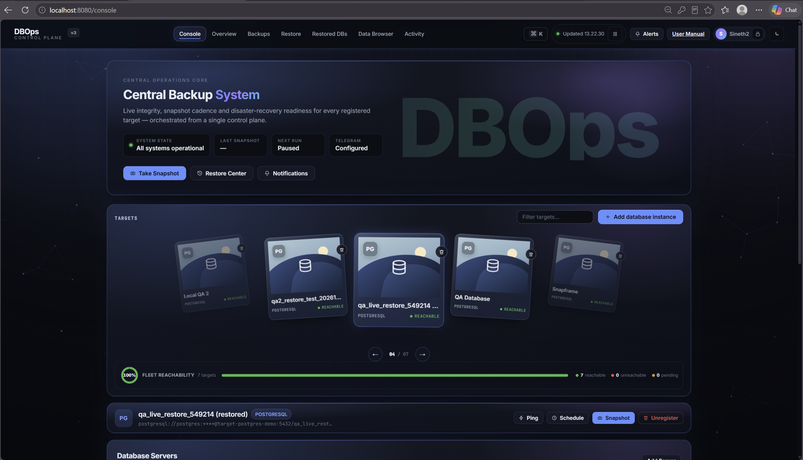<br><strong>Console and database targets</strong><br>Choose the active database and open common operations from the central dashboard.</td>
    <td align="center">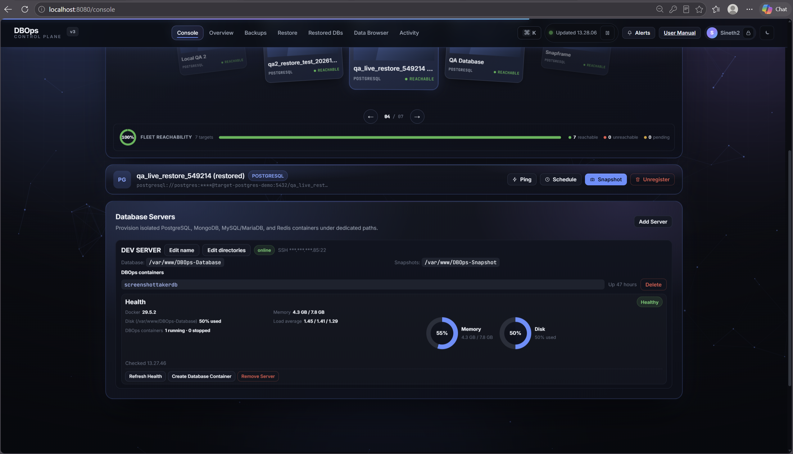<br><strong>Remote server management</strong><br>Review registered host health and the containers managed by DBOps.</td>
  </tr>
  <tr>
    <td align="center">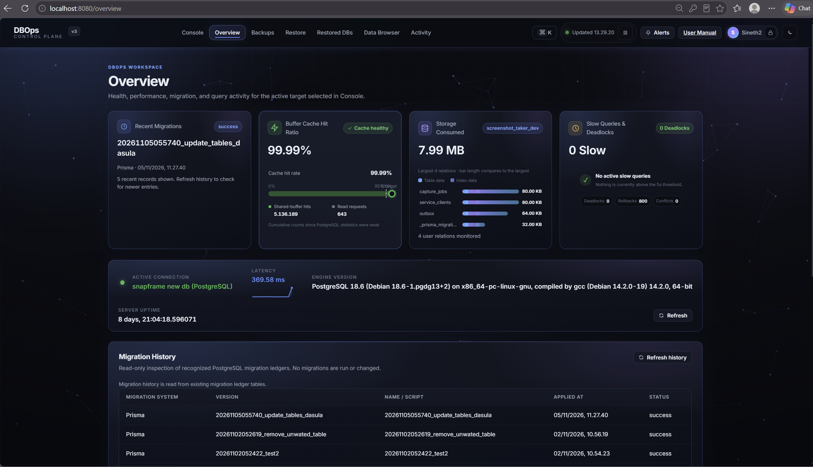<br><strong>Overview and migration history</strong><br>Inspect PostgreSQL health metrics and the migration records visible to the app.</td>
    <td align="center">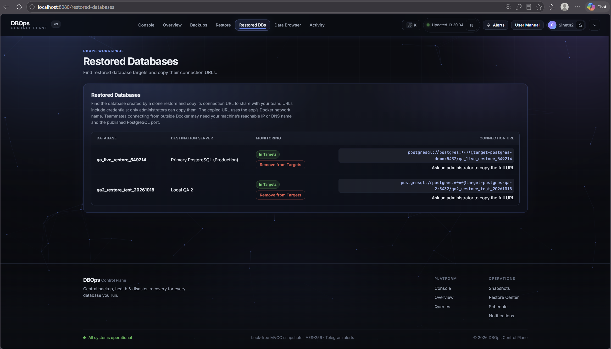<br><strong>Restored databases</strong><br>Find databases created by clone restores and manage their target registration.</td>
  </tr>
  <tr>
    <td align="center">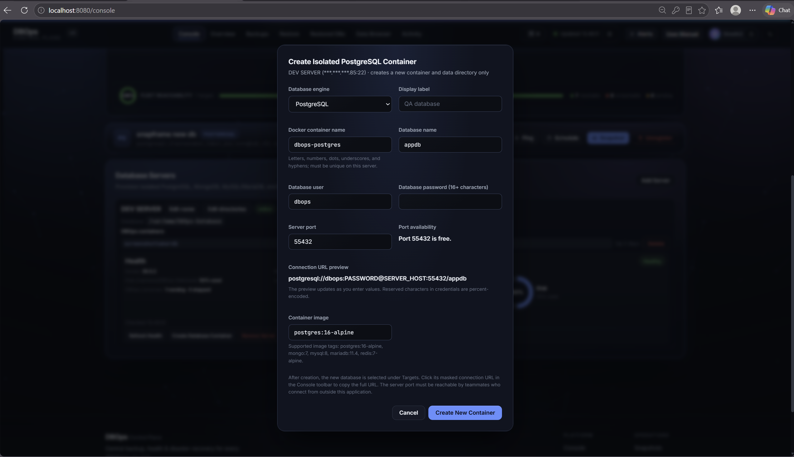<br><strong>Database container provisioning</strong><br>Configure a new isolated database container, check its server port, and preview its connection URL.</td>
    <td align="center">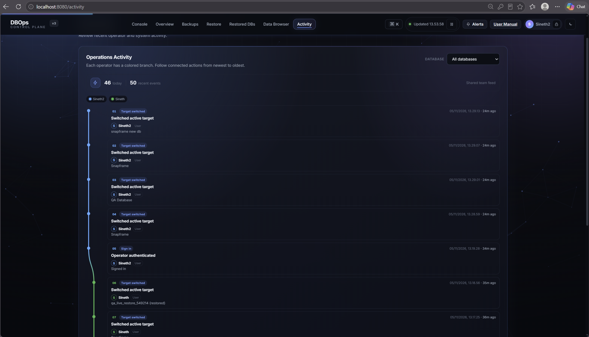<br><strong>Operations activity</strong><br>Review recent operator and system events in chronological order.</td>
  </tr>
  <tr>
    <td align="center">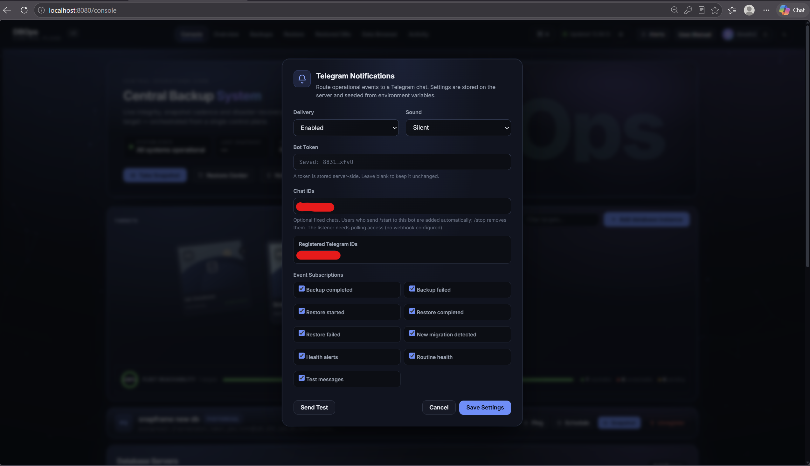<br><strong>Notification settings</strong><br>Configure Telegram delivery, recipients, event subscriptions, and test messages.</td>
    <td align="center">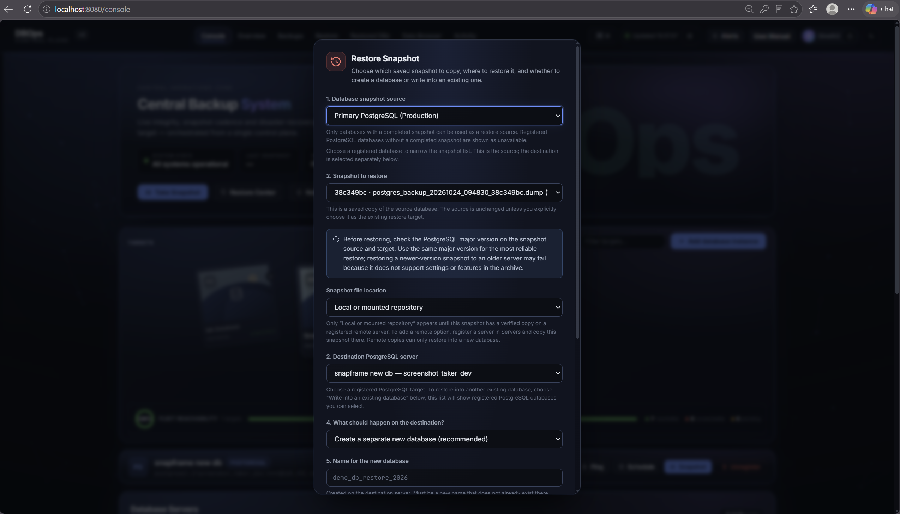<br><strong>Restore workflow</strong><br>Select a snapshot, destination server, and whether to create a new database or target an existing one.</td>
  </tr>
  <tr>
    <td align="center">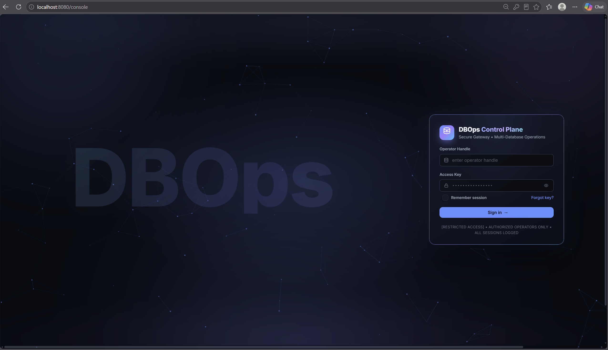<br><strong>Operator sign-in</strong><br>Authenticate to the control plane with an operator account.</td>
    <td align="center">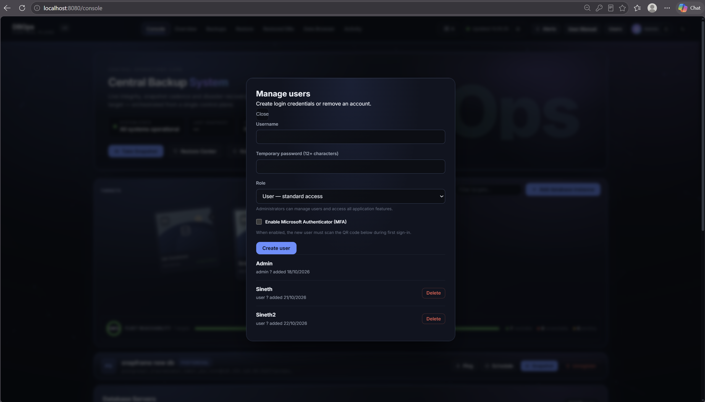<br><strong>User management</strong><br>Administrators can create or remove accounts, assign roles, and enable MFA.</td>
  </tr>
</table>

## Architecture

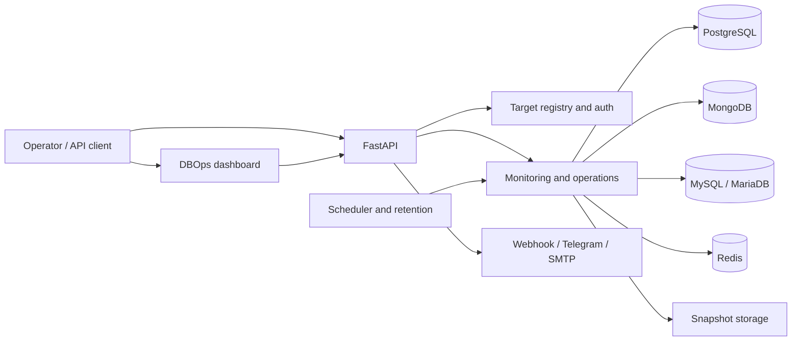

## Supported capabilities

| Capability | PostgreSQL | MongoDB | MySQL / MariaDB | Redis |
|---|---:|---:|---:|---:|
| Register and monitor | Yes | Yes | Yes | Yes |
| Health and engine-specific metrics | Yes | Yes | Yes | Yes |
| Snapshot creation | Yes | — | — | — |
| Archive verification and restore | Yes | — | — | — |
| Query / operation termination | Yes | Yes | Yes | — |

Monitoring coverage varies by engine and permission level. Registration confirms connectivity; it does not prove that a database account is read-only. Snapshot and restore operations currently support PostgreSQL only. Restore can create a new database, or explicitly apply a snapshot to an existing target; the latter changes that database and requires confirmation.

There is no generic safe way for DBOps to reverse a migration based only on its history row. Rollback needs the migration project's original code and its framework-specific down/undo logic; data deleted or overwritten by a migration may not be recoverable from that logic. Use the owning migration tool and review and test its rollback in a suitable environment. For shared or production databases, prefer a reviewed corrective migration or a verified backup restore plan. DBOps does not expose a one-click migration rollback.

## Quick start

### Docker Compose

1. Clone the repository and create your local environment file:

   ```bash
   git clone https://github.com/sinethch/Central-Database-Management-System.git
   cd Central-Database-Management-System
   cp .env.example .env
   ```

2. Edit `.env` before starting. Set a unique administrator password and generate separate, stable random values for `API_KEY`, `BACKUP_ENCRYPTION_KEY`, `DATABASE_CREDENTIAL_ENCRYPTION_KEY`, and `AUTH_TOTP_ENCRYPTION_KEY`. Set `SERVER_CREDENTIAL_ENCRYPTION_KEY` before registering remote servers. Keep `.env` private and preserve encryption keys securely; encrypted data cannot be recovered if its key is lost.

3. Build and start the application:

   ```bash
   docker compose up -d --build
   ```

4. Open [http://localhost:8080](http://localhost:8080) and sign in with the administrator credentials configured in `.env`.

To stop the services, run `docker compose down`. Persistent Docker volumes are retained unless explicitly removed.

### Local Python

Requires Python 3.12 and the database client tools needed for the engines and backup operations you plan to use.

```powershell
python -m venv .venv
.\.venv\Scripts\Activate.ps1
pip install -r requirements.txt
Copy-Item .env.example .env
# Edit .env and replace all example credentials and keys before running.
python -m uvicorn app.main:app --host 127.0.0.1 --port 8080
```

## Security and operational notes

- Keep `.env`, database files, backup archives, SSH host keys, and encryption keys out of source control. The repository ignores these local files by default.
- Change all example passwords and keys before use. Never reuse production credentials in a demo or QA deployment.
- Use least-privileged database accounts for monitoring. The app cannot enforce database-side permissions for you.
- Monitoring is designed to be read-oriented; actions such as terminating a query and restoring into an existing database can affect workloads or data.
- Remote server integration uses SSH and Docker. Access to a Docker daemon can provide root-level control of its host, so restrict the SSH account and network access.
- Do not expose the management interface publicly without TLS, strong authentication, and appropriate network controls.

## CI/CD deployment with GitHub Actions, GHCR, and Nginx

The workflow in `.github/workflows/deploy.yml` runs the existing pytest suite for pull requests and pushes to `main`. To publish a production release, create and publish a GitHub Release with a semantic version tag such as `v1.2.3`. After CI passes, the workflow publishes versioned and `latest` tags to GitHub Container Registry (GHCR), then deploys the specific release version over SSH. Production does not deploy from `latest`. Configure a GitHub Actions environment named `production`; configure required reviewers there if production deployments need approval.

### Prepare the Linux server once

1. Install Docker Engine and the Docker Compose plugin. Create `/opt/dbops` and `/opt/dbops/ssh`, and give the deployment user access to Docker and write access to `/opt/dbops`. Docker group membership is root-equivalent, so restrict this user and its SSH key.
2. Create `/opt/dbops/.env` on the server. Set the production database URL, a strong `API_KEY`, a unique `ADMIN_PASSWORD`, and stable unique encryption keys (`BACKUP_ENCRYPTION_KEY`, `DATABASE_CREDENTIAL_ENCRYPTION_KEY`, `AUTH_TOTP_ENCRYPTION_KEY`, and `SERVER_CREDENTIAL_ENCRYPTION_KEY`). Add any notification settings the deployment needs. Never copy the development `.env` or demo passwords into production.
3. Keep a verified SSH `known_hosts` file at `/opt/dbops/ssh/known_hosts`. Set `SSH_KNOWN_HOSTS_PATH=./ssh/known_hosts` in the server `.env`, or adjust the bind source in `docker-compose.production.yml` to the trusted file’s absolute path.
4. Point the domain's DNS `A` record (and `AAAA` if IPv6 is configured) at the server. Open inbound ports 80 and 443 (and restricted SSH) in the firewall; do not expose port 8080 publicly. Configure an Nginx site with a proxy to `http://127.0.0.1:8080`, forwarding the `Host`, `X-Real-IP`, `X-Forwarded-For`, and `X-Forwarded-Proto` headers. Allow long-running operations and streamed progress responses by setting appropriate proxy read timeouts and disabling buffering for the server provisioning stream endpoint. Validate and reload Nginx, then use Certbot with the Nginx plugin (`sudo certbot --nginx -d your-domain.example`) to issue the certificate and confirm automatic renewal is scheduled.
5. Give the deployment user authenticated access to the GHCR package. The workflow signs in on the server using a classic GitHub token with `read:packages`; use a dedicated account/token with the narrowest available access and rotate it as required.

### Configure GitHub Actions secrets

Add these repository or `production` environment secrets under **Settings → Secrets and variables → Actions**:

| Secret | Value |
|---|---|
| `DEPLOY_HOST` | Server DNS name or IP |
| `DEPLOY_USER` | Restricted SSH deployment account |
| `DEPLOY_SSH_KEY` | Private key for that account; add only its public key to the server |
| `DEPLOY_KNOWN_HOSTS` | Verified known-hosts line for the server, collected and checked out of band |
| `GHCR_USERNAME` | GitHub account that can pull the image |
| `GHCR_READ_TOKEN` | Token with `read:packages` access to the image |

Do not disable SSH host-key checking or use an unverified `ssh-keyscan` result as trust. After the first successful publication, set the GHCR package visibility and access so the deployment account can pull it.

### Deployment and rollback

Merge or push to `main` to run CI. Once ready to release, create a GitHub Release tagged with the next semantic version (`vMAJOR.MINOR.PATCH`, for example `v1.2.3`). Publishing the Release runs CI, builds and publishes the versioned image, then deploys that version. Review the Actions run and the server’s container health after deployment. The production Compose file exposes only localhost, leaving Nginx and Certbot on the host to serve HTTPS.

To roll back, SSH to the server and run:

```bash
cd /opt/dbops
IMAGE_NAME=ghcr.io/OWNER/REPOSITORY IMAGE_TAG=v1.2.2 docker compose -f docker-compose.production.yml pull dbops-control-plane
IMAGE_NAME=ghcr.io/OWNER/REPOSITORY IMAGE_TAG=v1.2.2 docker compose -f docker-compose.production.yml up -d --no-deps dbops-control-plane
```

Replace the example with the image name and semantic version of a previous successful release. Keep the server `.env`, encryption keys, and named backup volume intact during rollback. Database migrations or data changes may need their own recovery plan; this workflow does not automatically roll back database state.

## API

The versioned API is rooted at `/api/v1`. Protected endpoints accept an authenticated session or the configured `X-API-Key` header. API credentials belong in headers, never in URLs.

| Area | Example endpoints |
|---|---|
| Health and metrics | `GET /health`, `GET /metrics/connections`, `GET /metrics/slow-queries` |
| Database registry | `GET /databases`, `POST /databases`, `DELETE /databases/{id}` |
| Snapshots | `POST /backups/create`, `GET /backups`, `POST /backups/verify/{id}` |
| Restore | `POST /restores` |
| Storage and remote servers | `/storage/targets`, `/servers` |
| Actions | `POST /actions/ping`, `POST /actions/kill-query` |

Remote server provisioning creates a new isolated container and data directory for PostgreSQL, MongoDB, MySQL/MariaDB, or Redis. Before creation, DBOps checks the selected host port against Docker-published ports and host TCP listeners, then checks again immediately before starting the container. This is a point-in-time check; another process could bind the port afterward, so Docker's final bind remains authoritative. Existing containers are not stopped or reconfigured by this workflow.

## Project layout

```text
app/          FastAPI application, API routes, services, models, and web UI
scripts/      Demo database and setup SQL
tests/        Automated test suite
backups/      Local runtime state (ignored by Git)
```

## Testing

```powershell
python -m pytest tests -v
```

The manual walkthrough and test cases are documented in [TEST_CASE_PLAN.md](TEST_CASE_PLAN.md). It describes test procedures; it does not claim that every case has passed.

## Known scope

- Backup and restore currently support PostgreSQL; the other engines provide monitoring and selected operational actions.
- This is a self-hosted operations tool, not a managed database service or a substitute for tested disaster-recovery procedures.
- The included Compose database targets are for local development and recovery practice. Do not treat sample or default credentials as production-ready.

## Contributing

Issues and pull requests are welcome. Please avoid including credentials, real connection URLs, backup archives, or production data in reports and contributions.

## License

No license file is currently included. Until a license is added, assume that standard copyright applies and ask the repository owner before reusing or redistributing the code.

---

<div align="center">
Built to make database operations and recovery practice easier to see and repeat.
</div>
